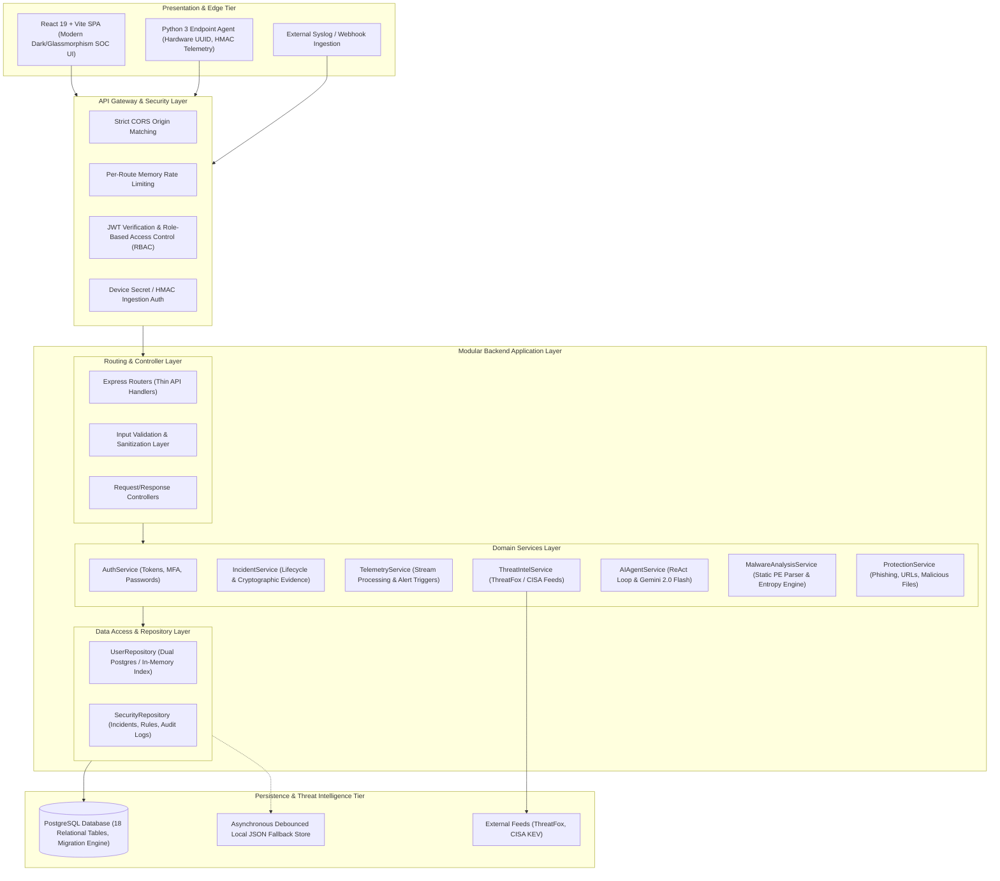
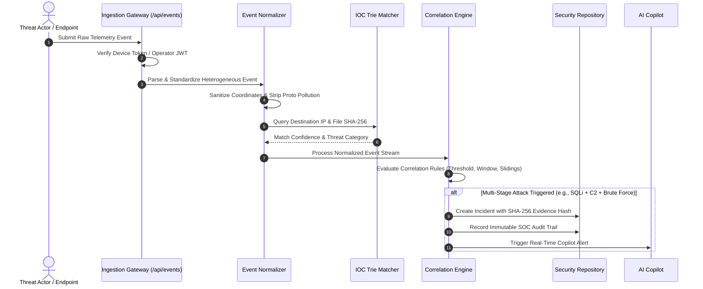
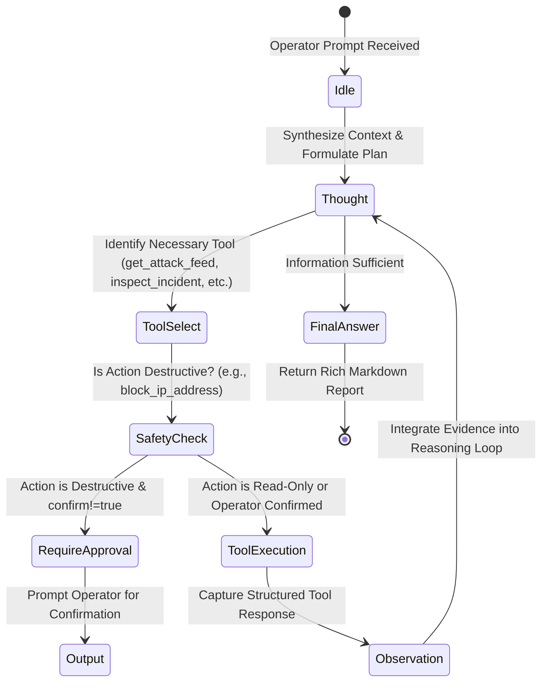

# Cyber Sentinel — System Architecture Specification

## 1. Executive Summary & Architectural Overview

**Cyber Sentinel** is an enterprise-grade Security Operations Center (SOC) platform, Endpoint Detection and Response (EDR) system, and AI-assisted Incident Investigation platform.

The system is designed around a decoupled, layered architecture prioritizing **zero-trust security**, **strict separation of concerns**, **predictable deterministic performance under load**, and **fail-closed configuration resilience**.



---

## 2. Core Architectural Principles

1. **Separation of Concerns**:
   - Presentation logic is strictly isolated in the React SPA.
   - All authorization checks, cryptographic signing, password hashing, and forensic evidence sealing execute exclusively on the backend.
   - Thin route handlers map HTTP verbs to controllers; controllers execute input validation; services implement business rules; repositories manage data persistence.

2. **Defense in Depth & Zero Trust**:
   - Strict input validation and sanitization prevent Prototype Pollution, SQL Injection, and ReDoS.
   - Endpoint telemetry requires authentic device secrets (`X-Device-Id` + `X-Device-Token`).
   - Destructive containment actions (e.g., perimeter IP blocking) enforce human-in-the-loop authorization gates.

3. **Performance Under Denial-of-Service / Event Storms**:
   - In-memory trie-based prefix tree indexing for Threat Intelligence lookups (sub-millisecond lookups across 1,000,000+ IOCs).
   - Asynchronous, debounced persistence for local fallback storage, preventing event-loop freezes during 1,000+ concurrent event bursts.

4. **Fail-Closed Security Configuration**:
   - In production (`NODE_ENV=production`), missing critical secrets (`DATABASE_URL`, `JWT_SECRET`, `DEVICE_SECRET`, `METRICS_TOKEN`) immediately abort process bootstrap.

---

## 3. Modular Backend Architecture

The backend (`backend/src/`) is organized into clean, uncoupled layers:

```
backend/src/
├── config/                  # Centralized, typed configuration with fail-closed validation
│   ├── index.js             # Environment parsing, port validation, secret verification
│   └── jwt.js               # Backward-compatible secret helper
├── constants/               # Global enumerations (Roles, Permissions, Event Types)
├── controllers/             # Request handling and HTTP response dispatching
│   ├── authController.js    # Registration, login, MFA, and token lifecycle
│   ├── incidentController.js# Incident query, creation, status transitions, timeline notes
│   └── ...
├── data/                    # Database drivers, migrations, and local persistence
│   ├── db.js                # PostgreSQL connection pool with transaction helper
│   ├── migrator.js          # Migration runner with SHA-256 checksum tracking
│   ├── migrations/          # Versioned DDL migrations (001_core, 002_indexes, 003_seed)
│   ├── securityStore.js     # Thread-safe security state store with async debounced writes
│   └── userStore.js         # Persistent user identity store
├── middleware/              # Authentication, authorization, rate limiting, and audit logging
│   ├── auth.js              # requireAuth, requireRole, requirePermission
│   └── rateLimiter.js       # Sliding-window rate limiters per sensitive endpoint
├── repositories/            # Data access abstractions separating business logic from SQL/disk
│   ├── userRepository.js    # User credential and profile queries
│   └── securityRepository.js# Incident, rule, and forensic log queries
├── routes/                  # Express route definitions linking middleware and controllers
├── services/                # Pure business logic and domain processing engines
│   ├── authService.js       # Password hashing, JWT signing, token rotation
│   ├── incidentService.js   # Forensic evidence hashing and status transitions
│   ├── normalizer/          # Unified event normalization & prototype pollution defense
│   ├── threatIntel/         # ThreatFox & CISA KEV ingestion and trie matching
│   └── ...
└── utils/                   # Shared cybersecurity engines and mathematical analyzers
    ├── auditLogger.js       # Immutable SOC audit logging
    ├── correlationEngine.js # Multi-stage sliding-window attack correlator
    ├── peAnalyzer.js        # Static PE malware analyzer & Shannon entropy calculator
    └── chatbot.js           # ReAct autonomous AI agent with Gemini 2.0 Flash
```

---

## 4. Ingestion, Threat Intelligence, & Correlation Pipeline



---

## 5. Threat Intelligence Engine

- **High-Performance Prefix Tree (Trie) Indexing**:
  - Millions of IP addresses and SHA-256 / MD5 hashes are indexed in a memory-efficient trie structure.
  - Sub-millisecond lookup latency ($< 0.05\text{ ms}$) even under millions of queries.
- **Dynamic Threat Feed Synchronization**:
  - Automatically fetches and updates indicators from **ThreatFox** (abuse.ch) and the **CISA Known Exploited Vulnerabilities (KEV)** catalog.
  - Graceful fallback to verified offline signatures when external network access is restricted.

---

## 6. Static PE Malware Analyzer

- **Safe In-Memory Binary Evaluation**:
  - Parses Portable Executable (PE32/PE32+) headers without executing the binary.
  - Computes byte-frequency **Shannon Entropy** ($H(X) = -\sum P(x) \log_2 P(x)$) to detect packed, encrypted, or obfuscated payloads (scores $> 7.2$ flag suspicious packing).
  - Inspects suspicious section names (`.upx`, `.vmp`, `.themida`), suspicious import tables (`VirtualAlloc`, `WriteProcessMemory`, `CreateRemoteThread`), and anomalous section counts.
  - Implements defensive bounds checking against section table header bombs (up to 65,535 fake sections) and corrupted pointer offsets (`e_lfanew`).

---

## 7. AI Security Copilot (ReAct Architecture)



- **ReAct Loop**: Iterative `Thought` $\rightarrow$ `Action` $\rightarrow$ `Observation` execution loop (maximum 8 iterations) powered by `gemini-2.0-flash`.
- **Human-in-the-Loop Safety Boundary**: Containment and firewall operations require explicit operator confirmation before execution.
- **Indirect Prompt Injection Defense**: Telemetry strings, log lines, and attack payloads are treated as inert forensic evidence, preventing prompt injection or persona tampering.

---

## 8. Database Architecture & Transaction Safety

- **18 Relational PostgreSQL Tables**:
  - Relational normalization with UUID primary keys, foreign key constraints (`ON DELETE CASCADE` / `ON DELETE RESTRICT`), and `TIMESTAMPTZ` audit timestamps.
- **Indexing Strategy**:
  - Composite indexes on `(status, created_at DESC)` and `(severity, created_at DESC)` for sub-millisecond SOC dashboard rendering.
  - GIN indexes on `jsonb` fields (`evidence`, `details`, `metadata`) for deep attribute queries.
  - Trigram indexes (`pg_trgm`) for fuzzy keyword search on threat indicators.
- **Transaction Safety**:
  - The `withTransaction(async (client) => { ... })` utility wraps multi-step relational operations in atomic `BEGIN` / `COMMIT` / `ROLLBACK` blocks.
- **Automated Checksum-Verified Migration System**:
  - SQL migrations are tracked in `schema_migrations` with deterministic SHA-256 checksums to detect unauthorized tampering or migration drift.

---

## 9. Verification & Quality Assurance

The architecture is verified by automated test suites:
- `npm test`: Capstone Pipeline Verification (9/9 passing).
- `npm run test:db`: Database Relational Integrity & Migration Suite (9/9 passing).
- `npm run test:worst-case`: Adversarial Stress, DoS, ReDoS, and Event Storm Suite (28/28 passing).
- `npm run test:adversarial`: Penetration Testing and RBAC Bypass Suite.
