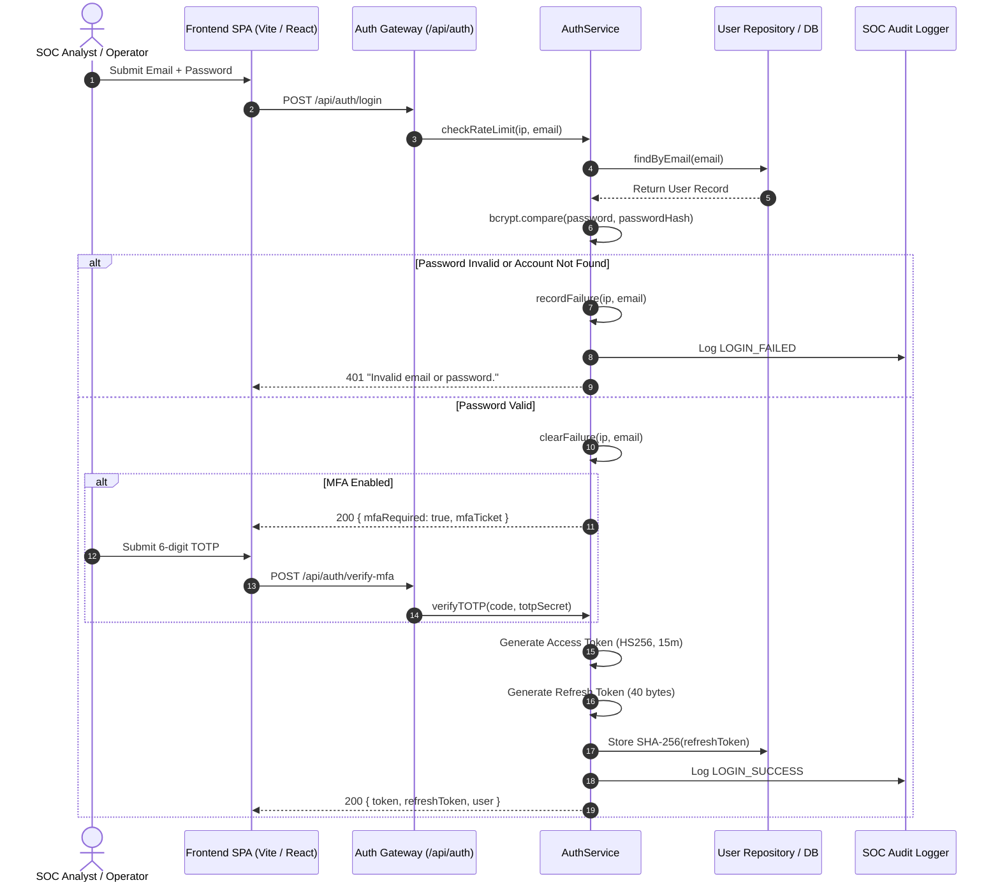
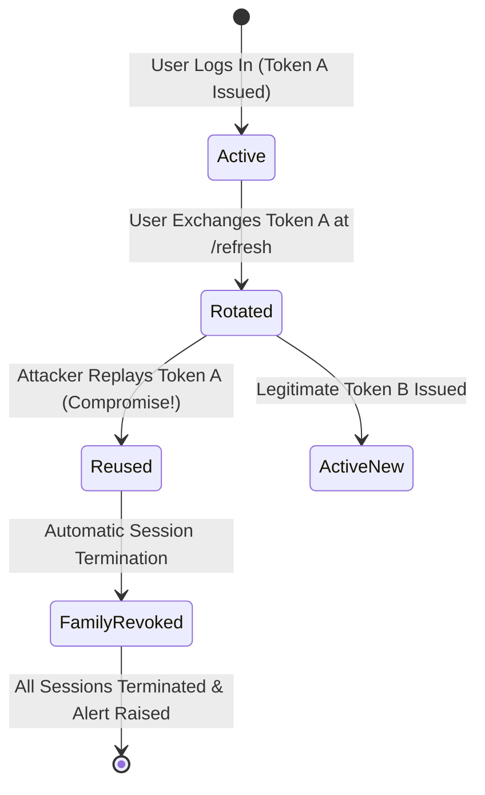

# Cyber Sentinel — Authentication & Identity Architecture Specification

## 1. Executive Summary

**Cyber Sentinel** enforces zero-trust identity verification, session integrity, and access governance adhering to **NIST SP 800-63B** (Digital Identity Guidelines) and **OWASP Authentication Verification Standards (ASVS)**.

The authentication layer provides:
- **Bcrypt Password Hashing** ($\ge 12$ salt rounds) with complexity validation and dictionary attack defense.
- **Short-Lived Access Tokens** with explicit HMAC-SHA256 (`HS256`) cryptographic verification.
- **Rotating Refresh Tokens** with SHA-256 hashed storage, family tracking, and replay attack compromise detection.
- **RFC 6238 TOTP Multi-Factor Authentication** with single-use challenge tickets.
- **Progressive Brute-Force Protection** and account lockout defenses.
- **Constant-Time Generic Error Responses** preventing user enumeration.
- **Full Session Invalidation** on password modification, token theft, or operator logout.

---

## 2. Authentication Architecture & Token Lifecycle



---

## 3. Core Security Controls

### A. Password Policy & Complexity Verification
- **NIST SP 800-63B Compliance**:
  - Minimum length: 8 characters (maximum 128 characters).
  - Character diversity: Requires at least 1 uppercase letter (`[A-Z]`), 1 lowercase letter (`[a-z]`), 1 numeric digit (`[0-9]`), and 1 special symbol (`[!@#$%^&*...]`).
  - Common Password Denylist: Automatically rejects predictable or breached passwords (e.g. `password123`, `admin1234`, `sentinel123`).
- **Cryptographic Storage**:
  - Passwords are encrypted using **Bcrypt** with **12 salt rounds** (`bcrypt.hash(password, 12)`).
  - Passwords are never logged or stored in plaintext.

### B. JWT Cryptographic Verification & Algorithm Hardening
- **Signature & Algorithm Enforcement**:
  - All access tokens are signed using **HMAC-SHA256** (`HS256`).
  - The verification middleware ([`middleware/auth.js`](file:///c:/Users/Ayush/OneDrive/Desktop/Cyber-Sentinel--main/backend/src/middleware/auth.js)) strictly configures `algorithms: ['HS256']`.
  - Rejects `none` algorithm bypass attempts, asymmetric RSA/HMAC confusion (`RS256`), and unsupported algorithms (`HS384`, `HS512`).
- **Token Structure & Claims Verification**:
  - Tokens must contain exactly 3 dot-separated Base64URL parts (`header.payload.signature`).
  - Mandatory claim enforcement: `sub`/`id`, `email`, and `role`. Missing required claims immediately returns `401 Unauthorized`.
- **Short Lifetime**:
  - Access tokens expire in **15 minutes** (`config.jwt.expiresIn`), minimizing exposure windows if a token is intercepted.

### C. Refresh-Token Lifecycle, Rotation, & Compromise Detection
- **Hashed Storage**:
  - Only the **SHA-256 hash** of refresh tokens (`token_hash`) is persisted in PostgreSQL / memory cache. Plaintext refresh tokens are never stored.
- **Automatic Token Rotation**:
  - Every valid token exchange at `POST /api/auth/refresh` issues a new access token and a **new rotating refresh token**, immediately revoking the previous refresh token.
- **Replay & Compromise Detection**:
  - Each token chain is tracked with a unique `familyId`.
  - If an attacker presents a revoked or already-consumed refresh token, Cyber Sentinel triggers a **critical compromise alert** (`TOKEN_REUSE_DETECTED`) and **immediately invalidates all active sessions** for that token family.



### D. Brute-Force & Credential Stuffing Mitigation
- **Progressive Account Lockout**:
  - Tracks consecutive failed authentication attempts by both **account email** and **client IP address**.
  - Exceeding **5 consecutive failures** within a 15-minute window immediately locks the account/IP for **15 minutes** (`429 Too Many Requests`).
  - Successful authentication immediately resets the failed attempts counter.
- **Anti-Enumeration Generic Responses**:
  - Both incorrect passwords and nonexistent accounts return an identical error: `"Invalid email or password."`.

### E. Session Invalidation & Secure Logout
- **Secure Logout**:
  - `POST /api/auth/logout`: Revokes the active refresh token hash immediately.
  - `POST /api/auth/logout-all`: Revokes all active refresh tokens associated with the authenticated operator.
- **Password Reset / Change Invalidation**:
  - Modifying or resetting an account passcode automatically terminates all active refresh tokens across all devices.

---

## 4. Role-Based Access Control (RBAC) & Authorization Architecture

Cyber Sentinel enforces strict server-side Role-Based Access Control with a **deny-by-default** policy across 5 standard roles:
- **`ADMIN`**: Super Administrator holding unrestricted privileges across all system configurations, user management, and security controls.
- **`SOC_ANALYST`**: Tier-2/Tier-3 Incident Responder authorized for threat triage, incident lifecycle modifications, forensic notes, and alert analysis.
- **`SECURITY_ENGINEER`**: Detection Engineer authorized for SIEM detection rule creation/tuning, threat intelligence ingestion, and malware analysis.
- **`ENDPOINT_OPERATOR`**: Fleet Administrator authorized for device telemetry, endpoint isolation, and response action execution.
- **`VIEWER`**: Read-only observer restricted to non-sensitive dashboard monitoring with zero execution or mutation privileges.

### Permission Matrix

| Permission Code | Domain Capability | ADMIN | SOC_ANALYST | SECURITY_ENGINEER | ENDPOINT_OPERATOR | VIEWER |
| :--- | :--- | :---: | :---: | :---: | :---: | :---: |
| `users:read`, `users:write`, `users:delete` | User & Role Management | ✅ | ❌ | ❌ | ❌ | ❌ |
| `devices:isolate`, `devices:write`, `devices:delete` | Endpoint Isolation & Fleet Management | ✅ | ❌ | ❌ | ✅ | ❌ |
| `devices:read` | Inspect Endpoint Telemetry & Hardware | ✅ | ✅ | ✅ | ✅ | ✅ |
| `telemetry:read` | Read Ingested Event Streams | ✅ | ✅ | ✅ | ✅ | ✅ |
| `telemetry:write`, `telemetry:ingest` | Ingest Telemetry Feeds | ✅ | ✅ | ❌ | ✅ | ❌ |
| `detections:read`, `detections:write` | View & Manage Correlated Detections | ✅ | ✅ | ✅ | ❌ | ✅ |
| `incidents:read` | View Incidents & Forensic Evidence | ✅ | ✅ | ✅ | ✅ | ✅ |
| `incidents:write`, `incidents:status` | Create, Triage & Transition Incidents | ✅ | ✅ | ❌ | ❌ | ❌ |
| `incidents:note` | Add Forensic Investigative Notes | ✅ | ✅ | ❌ | ✅ | ❌ |
| `threats:read` | Query IOC Feeds (ThreatFox, CISA KEV) | ✅ | ✅ | ✅ | ❌ | ✅ |
| `threats:write` | Ingest & Update Threat Intelligence Feeds | ✅ | ❌ | ✅ | ❌ | ❌ |
| `malware:read`, `malware:analyze` | Static PE Analysis & Shannon Entropy | ✅ | ✅ | ✅ | ✅ | ❌ |
| `rules:read` | Inspect SIEM Correlation Rules | ✅ | ✅ | ✅ | ❌ | ❌ |
| `rules:write`, `rules:delete` | Create, Update & Delete Detection Rules | ✅ | ❌ | ✅ | ❌ | ❌ |
| `response:execute` | Execute IP Blocking & Containment Actions | ✅ | ❌ | ❌ | ✅ | ❌ |
| `response:approve` | Approve Automated Response Actions | ✅ | ✅ | ❌ | ❌ | ❌ |
| `audit:read` | View Immutable SOC Audit Log Trail | ✅ | ✅ | ✅ | ✅ | ✅ |
| `system:read` | View Host Metrics & Environment Health | ✅ | ✅ | ❌ | ❌ | ❌ |
| `system:write` | Modify Infrastructure Configuration | ✅ | ❌ | ❌ | ❌ | ❌ |
| `ai:chat` | Autonomous SOC AI Copilot Access | ✅ | ✅ | ✅ | ✅ | ❌ |

### Authorization Defense Controls
1. **Server-Side Enforcement**: All authorization checks execute in Express middleware ([`middleware/auth.js`](file:///c:/Users/Ayush/OneDrive/Desktop/Cyber-Sentinel--main/backend/src/middleware/auth.js)) using `requireAuth`, `requireRole`, and `requirePermission`. Frontend UI checks are strictly cosmetic.
2. **Insecure Direct Object Reference (IDOR) Defense**: Middleware [`preventIdor('id')`](file:///c:/Users/Ayush/OneDrive/Desktop/Cyber-Sentinel--main/backend/src/middleware/auth.js) guarantees that non-admin users cannot access or modify records belonging to other operators.
3. **Privilege Escalation Defense**: Registration and profile updates discard any client-supplied `role`, `isAdmin`, `permissions`, or `status` flags. Roles can only be granted by an `ADMIN`.
4. **Mass Assignment Defense**: Inbound request parameters are sanitized and checked against strict whitelist models before storage.
5. **Deny-by-Default Policy**: Any unrecognized role or unmapped permission is rejected with `HTTP 403 Forbidden`.

---

## 5. Automated Security Verification

The authentication layer is verified by [`test_authentication_security.js`](file:///c:/Users/Ayush/OneDrive/Desktop/Cyber-Sentinel--main/backend/test_authentication_security.js) (`npm run test:auth`):

```bash
npm run test:auth
```

### Verified Test Cases (21 / 21 Passing):
1. **Password Policy**: Rejection of $< 8$ chars, missing uppercase/lowercase/digits/symbols, and dictionary words.
2. **Password Hashing**: Bcrypt cost factor $\ge 12$, verification of salt generation.
3. **Authentication**: Valid login, bad password, nonexistent account enumeration resistance.
4. **JWT Security**: Valid claims, expired token rejection, malformed token rejection, tampered signature rejection, `none` algorithm rejection, algorithm substitution rejection, missing claims rejection.
5. **Token Rotation**: SHA-256 hashed storage, single-use token rotation.
6. **Compromise Detection**: Reused refresh token replay detection and family session invalidation.
7. **Brute Force Defense**: 5 failed attempt threshold enforcing 15-minute lockout (`HTTP 429`).
8. **Session Invalidation**: Password reset revocation, explicit logout token revocation.
