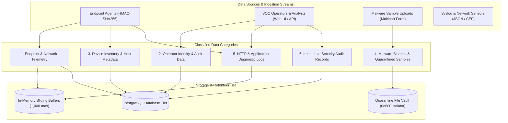
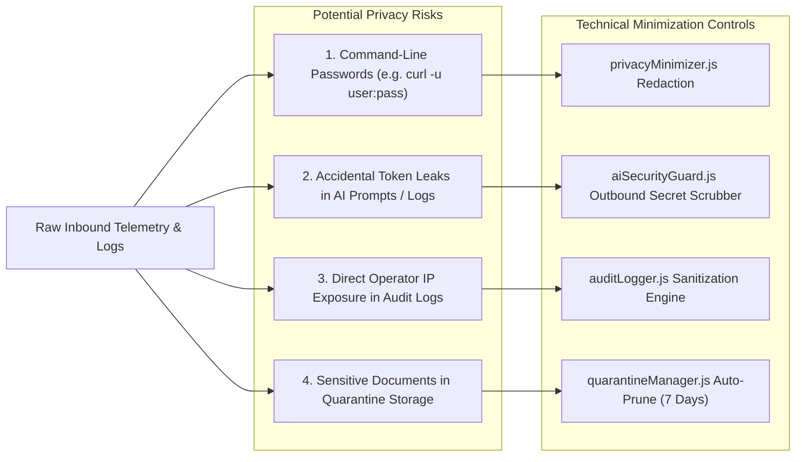
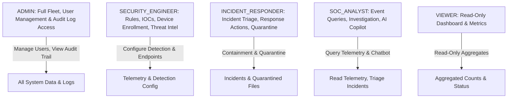

# Cyber Sentinel — Data Privacy & Minimization Architecture Document

## 🛡️ Executive Summary & Privacy-by-Design Scope

This document details the data privacy posture, telemetry collection boundaries, data minimization controls, and data lifecycle management policies of the **Cyber Sentinel** Security Operations Center (SOC) platform.

As an enterprise cybersecurity monitoring system, Cyber Sentinel processes security telemetry, user credentials, endpoint configurations, and malware payloads. This document analyzes every category of data collected, identifies unnecessary sensitive information, details the technical safeguards and data minimization measures implemented in code, and defines access control and retention policies.

> [!NOTE]
> This document details the **technical and architectural measures** implemented within Cyber Sentinel to support data privacy, data minimization, and secure data handling. It is not formal legal advice, nor does it make unilateral claims of third-party statutory compliance certification. Organizations deploying Cyber Sentinel should review these technical controls in conjunction with their internal legal, privacy, and Data Protection Impact Assessment (DPIA) frameworks.

---

## 📊 Data Inventory & Collection Taxonomy

---

## 🔬 Detailed Data Category Analysis

### 1. Telemetry Data Collected

Endpoint agents and network collectors stream real-time operational telemetry into `/api/events` and `/api/events/batch`.

| Sub-Object | Fields Collected | Description / Purpose | Sensitivity Level | Minimization & Privacy Safeguards |
| :--- | :--- | :--- | :---: | :--- |
| **Identification** | `event_id`, `timestamp`, `device_id`, `event_type`, `severity`, `source` | Identifies the event, time of occurrence, host ID, and security category for SIEM correlation. | **Low** | Canonical UUIDv4 validation; strict ISO-8601 UTC timestamp enforcement. |
| **Process** | `name`, `pid`, `ppid`, `path`, `command_line`, `hash`, `parent_name` | Tracks binary execution, parent-child process trees, and command execution for MITRE detection rules. | **High** | Strings clamped to `MAX_CMDLINE_LEN=1024`. Credential scrubbers (`privacyMinimizer.js`) sanitize embedded passwords (e.g., `--password <secret>`, `-u user:pass`). |
| **Network** | `source_ip`, `source_port`, `dest_ip`, `dest_port`, `protocol`, `direction`, `domain`, `bytes_sent`, `bytes_received` | Monitors ingress/egress TCP/UDP flows, DNS requests, and C2 beaconing. | **Medium** | Validated via strict IPv4/IPv6 regexes. Destination domain clamped to `MAX_DOMAIN_LEN=255`. Optional subnet masking (`192.168.1.0/24`) available for non-investigative telemetry. |
| **File** | `path`, `name`, `action`, `size_bytes`, `hash`, `extension` | Observes file drops, script modifications, ransomware encryption spikes, and unauthorized persistence. | **Medium** | File paths sanitized against null bytes and control characters; path lengths bounded to 512 characters. |
| **User Context** | `name`, `domain`, `id`, `email`, `is_admin` | Correlates privilege escalation, domain account usage, and unauthorized administrative actions. | **High** | Strips arbitrary custom attributes; lengths bounded (`MAX_USER_LEN=128`). Pseudonymization utility (`pseudonymizeUser()`) available for privacy-sensitive deployments. |
| **Metadata** | `tags`, `mitre_technique`, `ioc_match`, `custom` | Provides MITRE ATT&CK categorization, ThreatFox IOC enrichment, and auxiliary telemetry parameters. | **Medium** | Recursive cycle and depth defense (`MAX_NESTING_DEPTH=4`, `MAX_CUSTOM_KEYS=20`); prototype pollution defense blocks `__proto__` and `constructor`. |

---

### 2. User & Operator Information Collected

Cyber Sentinel collects identity and session information for human SOC operators and administrators during registration and daily platform access.

| Field Name | Type | Storage Format | Purpose of Collection | Access Control Tier |
| :--- | :--- | :--- | :--- | :--- |
| `id` | UUIDv4 | Plaintext UUID | Unique primary key identifier for operator accounts. | Internal system identifier |
| `email` | String | Lowercase string | Operator login identifier and communication address. | `ADMIN`, `SECURITY_ENGINEER` |
| `password_hash` | String | Salted Bcrypt hash (`cost=10`) | Cryptographic authentication credential. Raw plaintext is **never stored or logged**. | System authentication layer only |
| `role` | String | Enum (`ADMIN`, `SOC_ANALYST`, etc.) | Role-Based Access Control authorization enforcement. | `ADMIN` (managed via role assignment API) |
| `totp_secret` | String | Encrypted / Base32 | Shared secret for RFC 6238 Time-Based One-Time Passwords (2FA). | User profile & MFA validation |
| `refresh_tokens` | Array | SHA-256 Hashes (`token_hash`) | Token rotation family tracking; allows revoking active sessions without storing plaintext tokens. | System authentication layer only |
| `failed_login_count` | Integer | Counter (0–5) | Brute-force protection counter; triggers 15-minute account lockout upon reaching threshold. | Auth middleware |

---

### 3. Endpoint & Device Information Collected

Managed endpoints registered in the asset inventory `/api/devices`.

| Attribute | Description / Purpose | Privacy & Security Controls |
| :--- | :--- | :--- |
| `id` / `device_id` | Unique hardware / agent identifier (e.g. `DEV-WORKSTATION-01`). | Clamped to 64 alphanumeric characters. |
| `hostname` | Network computer name. | Normalized string; stripped of special characters. |
| `ip_address` | Host primary IP address for network routing and isolation. | Validated IPv4 / IPv6 syntax; no arbitrary strings allowed. |
| `os` & `os_version` | Operating system family (Windows, Linux, macOS) and kernel build. | Used strictly for detection rule scoping (e.g., PowerShell vs. Bash rules). |
| `agent_version` | Cyber Sentinel local sensor version. | Used to detect out-of-date or vulnerable agent sensors. |
| `status` | Fleet state (`ACTIVE`, `INACTIVE`, `REVOKED`, `ISOLATED`). | FSM-enforced lifecycle transitions. |
| `token_hash` | SHA-256 digest of the device's shared HMAC secret. | **Plaintext secret is never stored on the server**. Only the hash is retained for revocation verification. |
| `last_seen` | Timestamp of the most recent valid telemetry heartbeat. | Automatic offline flagging after 5 minutes of inactivity. |

---

### 4. Malware Samples & Uploaded Binaries

Cyber Sentinel accepts file uploads at `/api/malware/analyze` and `/api/protection/scan-file` for static reverse engineering and threat detection.

- **Data Collected**:
  - Original filename (e.g., `invoice.exe`)
  - File size (capped at `MAX_FILE_SIZE_BYTES = 10MB`)
  - Cryptographic hashes: SHA-256, SHA-1, MD5
  - Static structural indicators: PE header fields, section table entropy, imported Win32 API functions, embedded strings.
- **Handling & Storage**:
  - Uploaded samples are processed **entirely in memory**; files are **never executed** on the host.
  - Quarantined files are written to `uploads/quarantine/smpl-<uuid>.bin` using random UUID filenames (stripping original names to prevent directory traversal or confusion).
  - Quarantined files are saved with restrictive **`0o600` permissions** (read/write for the service account only; non-executable).

---

### 5. Application & HTTP Diagnostic Logs

Generated during platform operation across API routes.

- **Data Captured**: HTTP Method, URL path, HTTP response status code, execution duration (ms), request timestamp, and unique `requestId`.
- **Exclusions**:
  - Request and response body payloads containing passwords, tokens, or personal identifiers are **excluded** from standard access logs.
  - Server-side error handlers (`server.js`) strip stack traces and database internal error messages before transmitting responses to clients.

---

### 6. Security Audit Records

Generated by `backend/src/utils/auditLogger.js` and stored in the PostgreSQL `audit_logs` table / `securityStore.js`.

- **Fields Recorded**:
  - `id`: UUIDv4
  - `action`: Standardized event type (`LOGIN`, `PASSWORD_CHANGED`, `IP_BLOCKED`, `AI_ACTION_APPROVED`, etc.)
  - `actor`: Email of the operator or `'system'`
  - `actorRole`: Role of the operator at the time of execution
  - `target`: Resource identifier acted upon (e.g., `USER_402`, `185.220.101.5`)
  - `sourceIp`: Sanitized client IP address (`x-forwarded-for` / socket address)
  - `result`: Outcome (`SUCCESS` or `FAILURE`)
  - `details`: Structured context payload passed through `sanitizeAuditDetails()` to scrub credentials, tokens, and sensitive keys.
  - `timestamp`: UTC ISO-8601 timestamp.

---

## 🔍 Identification of Unnecessary Sensitive Information & Risk Areas

During code and architectural review, the following potential privacy risks and unnecessary sensitive data exposure paths were evaluated:

### Risk 1: Embedded Credentials in Command-Line Telemetry
- **Issue**: System administration scripts or malicious tools often invoke utilities with embedded credentials (e.g., `net use \\server /user:admin Secret123`, `curl -u admin:pass https://...`).
- **Mitigation Implemented**: The `privacyMinimizer.js` utility proactively detects and redacts passwords, basic auth tokens, and CLI secrets (`--password`, `-p`, `--secret`, `--token`) from command lines and unstructured metadata before SIEM rule processing and storage.

### Risk 2: Token and Secret Leakage in AI Chatbot Completions
- **Issue**: Analysts inquiring about incidents might accidentally paste raw configuration files or authorization headers, which the upstream AI model could reflect back in completions.
- **Mitigation Implemented**: `aiSecurityGuard.js` enforces `scrubOutboundSecretLeakage()`, which regex-scans all AI completions for Google API keys, JWT access tokens, Bearer authorization headers, and database connection strings before delivery to the analyst.

### Risk 3: Sensitive Authentication Parameters in Audit Logs
- **Issue**: When an analyst changes their password or updates an API configuration, the HTTP request body might contain `currentPassword` or `newPassword`.
- **Mitigation Implemented**: `auditLogger.js` routes all `details` objects through `sanitizeAuditDetails()`, stripping sensitive keys (`password`, `token`, `secret`, `mfaSecret`, `apiKey`, `cookie`) and replacing them with `[REDACTED_SECURITY_PARAM]`.

### Risk 4: Unbounded Sample Storage in Quarantine Vault
- **Issue**: Malware samples or uploaded files retained indefinitely pose storage bloat and potential data exposure risks.
- **Mitigation Implemented**: `quarantineManager.js` enforces automated file pruning (`pruneQuarantine()`), purging samples exceeding the configurable retention threshold (default: 7 days / 604,800,000 ms).

---

## ⏱️ Data Retention & Lifecycles

| Data Category | Storage Mechanism | Retention Period | Deletion / Pruning Mechanism |
| :--- | :--- | :--- | :--- |
| **Real-Time Telemetry Buffer** | In-Memory Circular Buffer | Volatile (Sliding window of 1,000 events) | FIFO eviction (oldest events evicted as new events arrive). |
| **Normalized Historical Events** | PostgreSQL `telemetry_events` | 90 Days (configurable by deployment) | Automated partitioned table drop / cron retention cleanup job. |
| **Active Incidents & Timelines** | PostgreSQL `incidents` / `timeline_events` | Minimum 1 Year (Forensic audit trail requirement) | Incidents can transition to `CLOSED` status. Due to cryptographic SHA-256 hash chaining, historical timeline rows are immutable (`405 Method Not Allowed` on delete). |
| **Quarantined Malware Files** | Local Disk Vault (`uploads/quarantine/`) | **7 Days** | `pruneQuarantine({ maxAgeMs: 7 * 86400000 })` automatically removes expired binary files and metadata. Manual deletion via `DELETE /api/malware/quarantine/:id`. |
| **Audit Logs** | PostgreSQL `audit_logs` | 365 Days (Compliance & accountability standard) | Retained for authorized administrator review; protected against deletion or modification by non-admin roles. |
| **User & Device Sessions** | Memory Store / DB Refresh Tokens | **2 Hours** (Access Token) / **7 Days** (Refresh Token) | Automatic expiration; instant global invalidation via `POST /api/auth/logout-all`. |

---

## 🔐 Access Control & Separation of Duties

Access to collected telemetry, incident files, and audit records is governed by strict Role-Based Access Control (RBAC):

### Access Control Matrix

| Role | Telemetry Ingestion | Incident Triage | Response Actions | Quarantine Mgmt | Audit Logs Access | User Management |
| :--- | :---: | :---: | :---: | :---: | :---: | :---: |
| **ADMIN** | ✅ | ✅ | ✅ (Approve & Execute) | ✅ Full | ✅ Full Read | ✅ Full CRUD |
| **SECURITY_ENGINEER** | ✅ | ✅ | ✅ (Propose & Approve) | ✅ Full | ❌ Forbidden | ❌ Forbidden |
| **INCIDENT_RESPONDER** | ✅ | ✅ | ✅ (Approve & Execute) | ✅ Read / Delete | ❌ Forbidden | ❌ Forbidden |
| **SOC_ANALYST** | ❌ (Read Only) | ✅ (Update Status) | ⚠️ (Propose Only) | 👁️ Read Only | ❌ Forbidden | ❌ Forbidden |
| **VIEWER** | ❌ Forbidden | 👁️ Read Only | ❌ Forbidden | ❌ Forbidden | ❌ Forbidden | ❌ Forbidden |

---

## 🗑️ Data Subject Rights, Erasure & Cryptographic Immutability

Cyber Sentinel balances individual privacy rights with mandatory forensic evidence preservation standards:

1. **User Account Erasure**:
   - Administrators can delete or deactivate human operator accounts (`DELETE /api/users/:id`).
   - Deletion removes the user record, active session tokens, and TOTP secrets from the database.
   - Historical audit logs retain the historical email address as a static forensic record of past administrative actions.

2. **Device De-Enrollment**:
   - Devices can be decommissioned via `POST /api/devices/:id/revoke`.
   - The device token is marked as `REVOKED`, immediately blocking future telemetry transmission.

3. **Forensic Timeline Immutability (Technical Constraint)**:
   - Security incidents record chronological investigation entries linked via **SHA-256 cryptographic hash chains**.
   - Because modifying or deleting a timeline event invalidates the root integrity hash of the incident, retrospective editing or deletion of individual timeline entries is disabled (`405 Method Not Allowed`).
   - Analysts may add corrective annotations (`ANALYST_NOTE`) rather than deleting historical events.

---

## 💡 Practical Recommendations for Deploying Organizations

Organizations deploying Cyber Sentinel in production environments should adopt the following data minimization best practices:

1. **Tune Endpoint Agent Collectors**: Configure endpoint sensors to collect process and network events only for monitored corporate executables, avoiding capturing local personal browsing activity where feasible.
2. **Enable CIDR Subnet Masking**: In environments with strict employee privacy requirements, enable the `maskIpAddress()` transformation on non-investigative telemetry to truncate endpoint IPs to `/24` subnets.
3. **Automate Quarantine Purging**: Ensure the `pruneQuarantine()` cron schedule is active to guarantee that uploaded binary files and scripts are automatically purged within 7 days.
4. **Conduct Regular Role Audits**: Regularly inspect operator role assignments via `GET /api/users` to ensure adherence to the Principle of Least Privilege.
