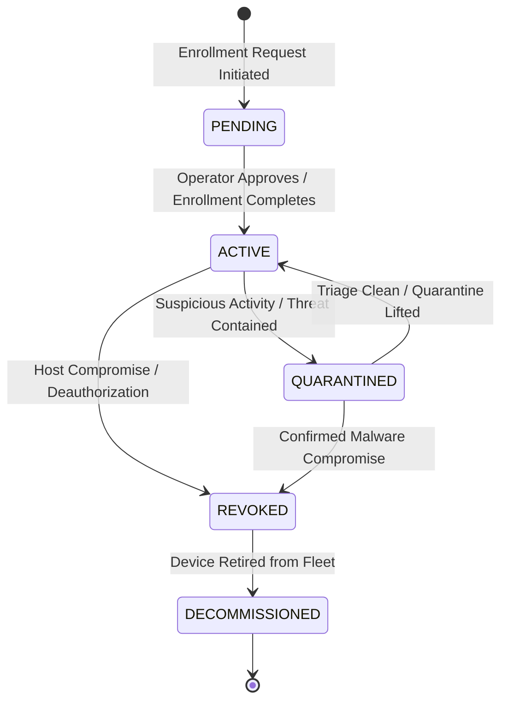
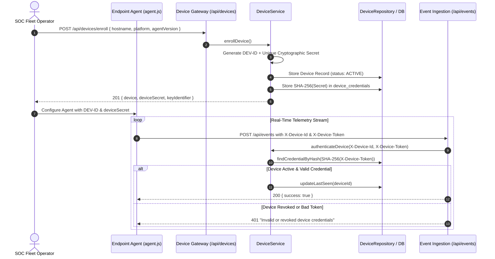

# Cyber Sentinel — Endpoint Device Enrollment & Lifecycle Protocol

## 1. Executive Summary

**Cyber Sentinel** enforces zero-trust endpoint enrollment and decentralized cryptographic key provisioning for all endpoint agents and telemetry sources.

Key security guarantees:
- **Zero Shared Secrets**: Every endpoint agent receives a unique, cryptographically random secret (`sec_<48-hex-bytes>`). No global shared key is reused across the fleet.
- **Hashed Storage**: Secrets are stored exclusively as **SHA-256 hashes** (`token_hash`) in the `device_credentials` table/store. Plaintext device secrets are never persisted or displayed after initial enrollment.
- **Enforced Lifecycle Governance**: Devices transition through explicit operational states (`PENDING` $\rightarrow$ `ACTIVE` $\rightarrow$ `QUARANTINED` $\rightarrow$ `REVOKED` $\rightarrow$ `DECOMMISSIONED`).
- **Seamless Credential Rotation**: Operators can rotate secrets on-demand, immediately invalidating old credentials and preventing replay or key theft.
- **Instant Revocation**: Revoking an endpoint immediately terminates telemetry ingestion access.

---

## 2. Device Lifecycle State Machine



### Lifecycle States:
1. **`PENDING`**: Initial enrollment initiated, awaiting verification or provisioning.
2. **`ACTIVE`**: Endpoint fully enrolled; telemetry stream ingestion authorized.
3. **`QUARANTINED`**: Host isolated from perimeter; restricted telemetry reporting only.
4. **`REVOKED`**: Credentials permanently invalidated; telemetry ingestion immediately blocked with `401 Unauthorized`.
5. **`DECOMMISSIONED`**: Host archived and permanently removed from active fleet management.

---

## 3. Enrollment & Authentication Protocol



---

## 4. REST API Reference

### 1. Enroll New Endpoint
- **Endpoint**: `POST /api/devices/enroll`
- **Authorization**: `requirePermission(PERMISSIONS.DEVICES_WRITE)` (ADMIN, ENDPOINT_OPERATOR)
- **Request Body**:
  ```json
  {
    "name": "Primary Linux SOC Gateway",
    "platform": "LINUX",
    "hostname": "srv-soc-prod-01",
    "agentVersion": "2.1.0",
    "ipAddress": "192.168.1.50"
  }
  ```
- **Response (201 Created)**:
  ```json
  {
    "success": true,
    "device": {
      "id": "DEV-3F8A1B2C4D5E6F70",
      "name": "Primary Linux SOC Gateway",
      "platform": "LINUX",
      "hostname": "srv-soc-prod-01",
      "status": "ACTIVE",
      "agentVersion": "2.1.0",
      "createdAt": "2026-09-15T22:14:00.000Z"
    },
    "deviceSecret": "sec_9a8b7c6d5e4f3a2b1c0d9e8f7a6b5c4d3e2f1a0b",
    "keyIdentifier": "KEY-123456-78",
    "message": "Endpoint successfully enrolled. Save the device secret securely; it will not be displayed again."
  }
  ```

### 2. List Enrolled Endpoints
- **Endpoint**: `GET /api/devices?status=ACTIVE&search=soc`
- **Authorization**: `requirePermission(PERMISSIONS.DEVICES_READ)`

### 3. Get Endpoint Details
- **Endpoint**: `GET /api/devices/:id`
- **Authorization**: `requirePermission(PERMISSIONS.DEVICES_READ)`

### 4. Rotate Device Credentials
- **Endpoint**: `POST /api/devices/:id/rotate-credential`
- **Authorization**: `requirePermission(PERMISSIONS.DEVICES_WRITE)`
- **Response (200 OK)**:
  ```json
  {
    "success": true,
    "deviceId": "DEV-3F8A1B2C4D5E6F70",
    "newDeviceSecret": "sec_1f2e3d4c5b6a7f8e9d0c1b2a3f4e5d6c7b8a9f0e",
    "keyIdentifier": "KEY-987654-32",
    "message": "New device credential generated. Old credentials have been invalidated."
  }
  ```

### 5. Revoke Endpoint Access
- **Endpoint**: `POST /api/devices/:id/revoke`
- **Authorization**: `requirePermission(PERMISSIONS.DEVICES_DELETE)`
- **Request Body**:
  ```json
  {
    "reason": "Host suspected of lateral movement compromise"
  }
  ```
- **Response (200 OK)**:
  ```json
  {
    "success": true,
    "message": "Endpoint DEV-3F8A1B2C4D5E6F70 (srv-soc-prod-01) revoked and all credentials permanently invalidated.",
    "device": {
      "id": "DEV-3F8A1B2C4D5E6F70",
      "status": "REVOKED"
    }
  }
  ```

---

## 5. Automated Verification Suite

The device enrollment architecture is verified by [`backend/test_device_enrollment.js`](file:///c:/Users/Ayush/OneDrive/Desktop/Cyber-Sentinel--main/backend/test_device_enrollment.js) (`npm run test:device`):

```bash
npm run test:device
```

### Verified Test Scenarios (10 / 10 Passing):
1. **Valid Enrollment**: Unique secret generation, `DEV-` ID assignment, `ACTIVE` lifecycle state.
2. **Hashed Storage**: Verification that only SHA-256 hash exists in credential storage.
3. **Telemetry Ingestion**: Authenticated event dispatch using `X-Device-Id` and `X-Device-Token`.
4. **Duplicate Enrollment Defense**: Prevention of conflicting active hostnames.
5. **Credential Rotation**: Issuing new secret, invalidating old secret in storage.
6. **Old Secret Rejection**: Verifying that previously rotated secret fails authentication (`401 Unauthorized`).
7. **Device Revocation**: Status transition to `REVOKED`, invalidating all credentials.
8. **Revoked Telemetry Lockdown**: Immediate rejection of telemetry from revoked devices.
9. **Zero Shared Credentials**: Verification that different devices receive unique isolated secrets and cannot cross-authenticate.
