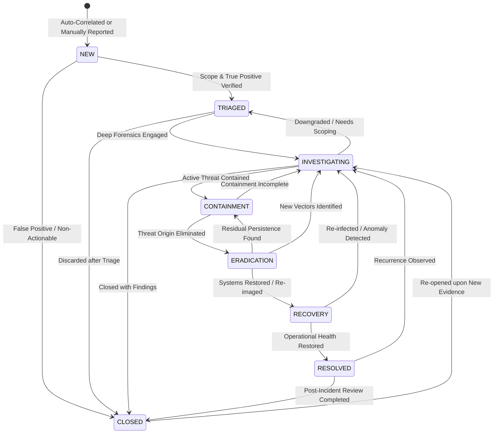

# Cyber Sentinel — SOC Incident Management & Lifecycle Architecture

## 1. Executive Overview

Cyber Sentinel implements a structured, professional Security Operations Center (SOC) incident response workflow aligned with **NIST SP 800-61 Rev 2** (*Computer Security Incident Handling Guide*) and the **SANS Incident Handler's Handbook**.

The engine strictly enforces legal state transitions on the backend, rejects arbitrary status manipulation, maintains immutable append-only audit trails, and preserves cryptographic SHA-256 evidence digests for forensic verification.

---

## 2. Canonical 8-State Lifecycle



### State Definitions

| State | Purpose | Typical Action |
| :--- | :--- | :--- |
| `NEW` | Unacknowledged incident newly ingested from detection engine or manual report. | Initial alert prioritization and dispatch. |
| `TRIAGED` | Initial verification performed; true positive confirmed, scope assessed. | Severity calibration and analyst assignment. |
| `INVESTIGATING` | Active digital forensics, memory analysis, process lineage tracing, network flow review. | Extraction of IOCs and MITRE ATT&CK attribution. |
| `CONTAINMENT` | Limiting blast radius; preventing lateral movement or data exfiltration. | Network isolation, perimeter IP firewall drop, account lockout. |
| `ERADICATION` | Complete removal of adversary presence from the enterprise environment. | Process termination, malware binary deletion, persistence key wipe. |
| `RECOVERY` | Restoring systems to clean, known-good operational state. | Restoring from immutable backups, re-imaging, credential resets. |
| `RESOLVED` | Incident remediation verified complete; services operating normally. | SOC Lead sign-off, monitoring for recurrence. |
| `CLOSED` | Final disposition recorded with post-incident retrospective and lessons learned. | Archival, immutable audit log finalization. |

---

## 3. Server-Side State Machine & Security Enforcement

State transitions are governed by `incidentStateMachine.js`. The server **fails closed** on any transition not explicitly permitted in the state graph.

### Permitted Transitions Table

| Current State (`from`) | Permitted Next States (`to`) | Forbidden Transitions (Examples) |
| :--- | :--- | :--- |
| `NEW` | `TRIAGED`, `CLOSED` | $\times$ `RESOLVED`, `CONTAINMENT`, `ERADICATION`, `RECOVERY` |
| `TRIAGED` | `INVESTIGATING`, `CLOSED` | $\times$ `RESOLVED`, `RECOVERY`, `ERADICATION` |
| `INVESTIGATING` | `CONTAINMENT`, `TRIAGED`, `CLOSED` | $\times$ `RESOLVED`, `RECOVERY` |
| `CONTAINMENT` | `ERADICATION`, `INVESTIGATING` | $\times$ `RESOLVED`, `CLOSED`, `RECOVERY` |
| `ERADICATION` | `RECOVERY`, `CONTAINMENT`, `INVESTIGATING` | $\times$ `RESOLVED`, `CLOSED`, `TRIAGED` |
| `RECOVERY` | `RESOLVED`, `INVESTIGATING` | $\times$ `CONTAINMENT`, `TRIAGED`, `NEW` |
| `RESOLVED` | `CLOSED`, `INVESTIGATING` | $\times$ `NEW`, `TRIAGED`, `CONTAINMENT` |
| `CLOSED` | `INVESTIGATING` *(Re-open only)* | $\times$ `NEW`, `TRIAGED`, `CONTAINMENT`, `RESOLVED` |

> [!IMPORTANT]
> Idempotent transitions (e.g. `TRIAGED` $\rightarrow$ `TRIAGED`) or jumping from `NEW` directly to `RESOLVED` are strictly prohibited and return `400 Bad Request`.

---

## 4. Full Incident Entity Schema

Every incident object in Cyber Sentinel is modeled with the following fields:

```json
{
  "id": "INC-2026-88129",
  "title": "Ransomware Outbreak on Finance Subnet",
  "description": "Multiple endpoints reporting VSS deletion and locked .enc files.",
  "severity": "CRITICAL",
  "confidence": 95,
  "status": "CONTAINMENT",
  "assignee": "alex.vance@cybersentinel.local",
  "affectedDevices": ["DEV-FIN-01", "DEV-FIN-02", "DEV-FIN-03"],
  "detections": ["det-e3251aa6", "det-4820bc12"],
  "indicators": ["198.51.100.77", "185.220.101.5", "e3b0c44298fc1c149afbf4c8996fb92427ae41e4649b934ca495991b7852b855"],
  "mitreTechniques": [
    {
      "id": "T1490",
      "technique_id": "T1490",
      "technique_name": "Inhibit System Recovery",
      "tactic": "Impact",
      "url": "https://attack.mitre.org/techniques/T1490/"
    },
    {
      "id": "T1486",
      "technique_id": "T1486",
      "technique_name": "Data Encrypted for Impact",
      "tactic": "Impact",
      "url": "https://attack.mitre.org/techniques/T1486/"
    }
  ],
  "notes": [
    {
      "id": "note-1742321456-42",
      "author": "Alex Vance (senior_analyst)",
      "note": "Perimeter firewall drop rules applied for malicious C2 IP 185.220.101.5.",
      "createdAt": "2026-09-15T17:25:00.000Z"
    }
  ],
  "responseActions": [
    {
      "id": "act-1742321460-88",
      "actionType": "ISOLATE_HOST",
      "target": "DEV-FIN-01",
      "parameters": { "vlan": "QUARANTINE_ISOLATION" },
      "status": "EXECUTED",
      "executedBy": "Alex Vance (senior_analyst)",
      "timestamp": "2026-09-15T17:26:00.000Z"
    }
  ],
  "evidence": {
    "payload": { "encryptedFilesCount": 24, "targetDrive": "C:" },
    "sha256": "4b227777d4dd1fc61c6f884f48641d02b4d121d3fd328cb08b5531fcacdabf8a",
    "preservedAt": "2026-09-15T17:20:00.000Z"
  },
  "timeline": [
    {
      "timestamp": "2026-09-15T17:20:00.000Z",
      "action": "INCIDENT_CREATED",
      "actor": "Detection Engine [RULE_RANSOMWARE_BURST_007]",
      "note": "Incident automatically flagged and correlated: Ransomware Outbreak on Finance Subnet",
      "previousStatus": null,
      "newStatus": "NEW"
    },
    {
      "timestamp": "2026-09-15T17:22:00.000Z",
      "action": "STATUS_CHANGE",
      "actor": "Alex Vance (senior_analyst)",
      "note": "Status transitioned from NEW to TRIAGED",
      "previousStatus": "NEW",
      "newStatus": "TRIAGED"
    }
  ],
  "createdAt": "2026-09-15T17:20:00.000Z",
  "updatedAt": "2026-09-15T17:26:00.000Z",
  "resolvedAt": null,
  "closedAt": null
}
```

---

## 5. REST API Reference

| Endpoint | Method | Role Required | Description |
| :--- | :--- | :--- | :--- |
| `/api/incidents` | `GET` | Authenticated | List incidents (supports `?status=`, `?severity=`, `?assignee=`, `?search=`, `?limit=`, `?offset=`). |
| `/api/incidents/:id` | `GET` | Authenticated | Retrieve complete incident record with timeline and evidence. |
| `/api/incidents` | `POST` | Authenticated | Create manual incident. |
| `/api/incidents/:id` | `PATCH` | Authenticated | Update incident metadata (confidence, severity, affected devices, indicators). |
| `/api/incidents/:id/status`| `POST` / `PATCH`| `senior_analyst` / `admin` | Advance or revert incident lifecycle state (server-side validated). |
| `/api/incidents/:id/assign`| `POST` / `PATCH`| `senior_analyst` / `admin` | Assign incident to an analyst or workload queue. |
| `/api/incidents/:id/close` | `POST` | `senior_analyst` / `admin` | Close incident with disposition reason and notes. |
| `/api/incidents/:id/notes` | `POST` | Authenticated | Append timestamped analyst note to timeline. |
| `/api/incidents/:id/response-actions` | `POST` | `senior_analyst` / `admin` | Record executed containment or remediation response action. |

---

## 6. Verification & Automated Test Coverage

The test suite (`npm run test:incident`) verifies:
1. Incident creation with all required SOC fields and initial `NEW` status.
2. Complete NIST lifecycle progression (`NEW` $\rightarrow$ `TRIAGED` $\rightarrow$ `INVESTIGATING` $\rightarrow$ `CONTAINMENT` $\rightarrow$ `ERADICATION` $\rightarrow$ `RECOVERY` $\rightarrow$ `RESOLVED` $\rightarrow$ `CLOSED`).
3. Re-opening closed incidents (`CLOSED` $\rightarrow$ `INVESTIGATING`).
4. Rejection of illegal transitions (`NEW` $\rightarrow$ `RESOLVED`, `NEW` $\rightarrow$ `CONTAINMENT`).
5. Rejection of idempotent transitions (`TRIAGED` $\rightarrow$ `TRIAGED`) and invalid status strings.
6. Incident assignment and metadata updating.
7. Note append operations and response action recording.
8. Multi-parameter search, status/severity filtering, and pagination.
9. Immutable audit log generation for all sensitive lifecycle events.

```bash
cd backend
npm run test:incident
```
