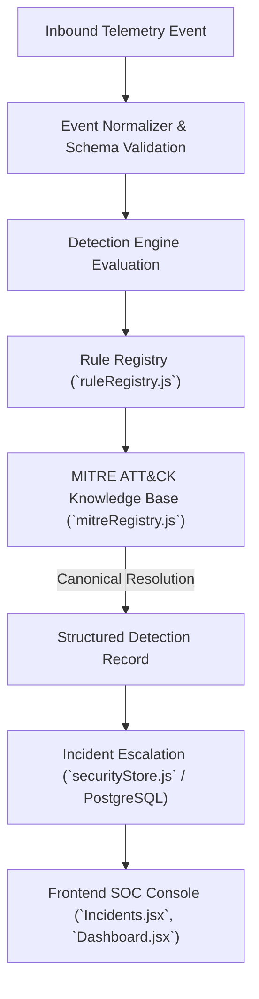

# Cyber Sentinel — MITRE ATT&CK Enterprise Matrix Integration

## 1. Executive Summary

Cyber Sentinel natively integrates the **MITRE ATT&CK Enterprise Framework**, mapping every telemetry event, detection rule, sliding correlation window, and escalated security incident to canonical adversary tactics, techniques, and sub-techniques.

Every detection in Cyber Sentinel carries a structured, verifiable attribution payload containing:
* **Tactic**: High-level adversary objective (e.g. *Credential Access*, *Execution*, *Defense Evasion*, *Initial Access*, *Impact*, *Command and Control*).
* **Technique ID & Technique Name**: Canonical parent identifier (e.g. `T1003` — *OS Credential Dumping*).
* **Sub-Technique ID & Sub-Technique Name**: Granular procedural specification (e.g. `T1003.001` — *LSASS Memory*).
* **Evidence**: Verifiable forensic artifacts (process command-line arguments, IP addresses, ports, sequence stages, file modification counts, payload signatures).
* **Confidence**: Statistical and heuristic certainty score ($0\text{--}100\%$).
* **Direct MITRE URL**: Interactive reference links to official MITRE matrix documentation (`https://attack.mitre.org/techniques/...`).

---

## 2. Architecture & Data Flow



---

## 3. Structured Data Model

### A. MITRE Technique Object Schema
```json
{
  "id": "T1003.001",
  "technique_id": "T1003",
  "technique_name": "OS Credential Dumping",
  "sub_technique_id": "T1003.001",
  "sub_technique_name": "LSASS Memory",
  "tactic_id": "TA0006",
  "tactic": "Credential Access",
  "matrix": "Enterprise ATT&CK",
  "description": "Adversaries may attempt to access credential material stored in the process memory of the Local Security Authority Subsystem Service (LSASS).",
  "url": "https://attack.mitre.org/techniques/T1003/001/",
  "platforms": ["Windows"]
}
```

### B. Standardized Detection Output with MITRE Attribution
```json
{
  "detection_id": "det-e3251aa6-3694-46c5-a0cf-7dbd935aa035",
  "rule_id": "RULE_MIMIKATZ_CRED_DUMP_001",
  "rule_name": "Mimikatz LSASS Credential Dumping Activity",
  "rule_version": "1.2.0",
  "severity": "CRITICAL",
  "confidence": 98,
  "event_type": "PROCESS_EXECUTION",
  "device_id": "DEV-WORKSTATION-01",
  "source_ip": "198.51.100.12",
  "mitre_techniques": [
    {
      "id": "T1003.001",
      "technique_id": "T1003",
      "technique_name": "OS Credential Dumping",
      "sub_technique_id": "T1003.001",
      "sub_technique_name": "LSASS Memory",
      "tactic": "Credential Access",
      "url": "https://attack.mitre.org/techniques/T1003/001/"
    }
  ],
  "evidence": {
    "triggeringEventId": "9e5c464c-f173-4ea2-8086-2c5e523f6634",
    "eventType": "PROCESS_EXECUTION",
    "deviceId": "DEV-WORKSTATION-01",
    "processName": "mimikatz.exe",
    "commandLine": "mimikatz.exe \"sekurlsa::logonpasswords\"",
    "user": "victim_user",
    "matchedAt": "2026-09-15T17:15:00.000Z"
  },
  "recommended_investigation": [
    "1. Immediately isolate endpoint from the enterprise network.",
    "2. Force enterprise-wide credential resets for accounts active on this workstation.",
    "3. Inspect memory dump locations and purge artifacts from disk."
  ],
  "incident_id": "INC-2026-88129"
}
```

---

## 4. Baseline Rules & ATT&CK Catalog Mapping

| Rule ID | Rule Name | Detection Model | MITRE Tactic | Technique ID | Sub-Technique | Confidence |
| :--- | :--- | :--- | :--- | :--- | :--- | :--- |
| `RULE_MIMIKATZ_CRED_DUMP_001` | Mimikatz LSASS Credential Dumping | `SINGLE_EVENT` | Credential Access | `T1003` | `T1003.001` (LSASS Memory) | **98%** |
| `RULE_OBFUSCATED_POWERSHELL_002` | Obfuscated PowerShell Execution | `SINGLE_EVENT` | Execution / Defense Evasion | `T1059` / `T1027` | `T1059.001` (PowerShell) | **90%** |
| `RULE_SHADOW_COPY_DELETION_003` | Volume Shadow Copy Deletion | `SINGLE_EVENT` | Impact | `T1490` | `T1490` (Inhibit System Recovery) | **99%** |
| `RULE_SQLI_SUCCESS_004` | Web SQL Injection Exploit | `SINGLE_EVENT` | Initial Access | `T1190` | `T1190` (Exploit Public-Facing App) | **95%** |
| `RULE_BRUTE_FORCE_005` | Brute Force Authentication | `THRESHOLD` | Credential Access | `T1110` | `T1110.001` / `T1110.003` | **90%** |
| `RULE_PORT_SCAN_006` | Network Port Scan Reconnaissance | `THRESHOLD` | Discovery | `T1046` | `T1046` (Network Service Discovery)| **85%** |
| `RULE_RANSOMWARE_BURST_007` | Rapid Mass File Encryption Burst | `THRESHOLD` | Impact | `T1486` | `T1486` (Data Encrypted for Impact)| **96%** |
| `RULE_KILL_CHAIN_SEQUENCE_008` | Multi-Stage Kill Chain Sequence | `SEQUENCE` | Initial Access $\rightarrow$ Execution $\rightarrow$ Impact | `T1190`, `T1059`, `T1490` | `T1059.001` | **99%** |
| `RULE_ACCOUNT_TAKEOVER_009` | Account Takeover Sequence | `SEQUENCE` | Credential Access $\rightarrow$ Persistence $\rightarrow$ Priv Escalation | `T1110`, `T1078`, `T1098` | `T1110.001` | **92%** |
| `RULE_C2_PROCESS_CORRELATION_010`| Process Execution with C2 Socket | `CORRELATION` | Execution $\rightarrow$ Command and Control | `T1059`, `T1071` | `T1059.001`, `T1071.001` | **98%** |

---

## 5. Dynamic Technique Registration (Extensibility)

New ATT&CK techniques or sub-techniques can be registered dynamically at runtime without modifying detection engine evaluation logic:

```javascript
const { mitreRegistry } = require('./services/detection/mitreRegistry');

// Register on-demand or from dynamic CTI feed
mitreRegistry.registerTechnique({
  id: 'T1555.003',
  technique_name: 'Credentials from Password Stores',
  sub_technique_name: 'Credentials from Web Browsers',
  tactic_id: 'TA0006',
  tactic: 'Credential Access',
  description: 'Adversaries may acquire credentials from web browsers by reading database or vault files.'
});
```

---

## 6. Frontend Presentation

* **Incident Forensics Console ([Incidents.jsx](file:///c:/Users/Ayush/OneDrive/Desktop/Cyber-Sentinel--main/frontend/src/pages/Incidents.jsx))**:
  * Displays structured **MITRE ATT&CK Matrix Cards** with tactic badges, parent technique name, sub-technique ID, and direct links to MITRE documentation.
  * Dedicated **Evidence Preservation & Integrity Drawer** displaying raw evidence, confidence rating, and verified cryptographic SHA-256 hashes.
* **Operational Threat Matrix ([Dashboard.jsx](file:///c:/Users/Ayush/OneDrive/Desktop/Cyber-Sentinel--main/frontend/src/pages/Dashboard.jsx))**:
  * Threat Event Inspector modal renders tactical mappings with Tactic pill and Technique ID.
* **Threat Intelligence Feed ([ThreatIntel.jsx](file:///c:/Users/Ayush/OneDrive/Desktop/Cyber-Sentinel--main/frontend/src/pages/ThreatIntel.jsx))**:
  * Continuous correlation between CVE vulnerabilities, CISA KEV entries, and MITRE ATT&CK tactics.

---

## 7. Verification & Automated Test Coverage

The test suite (`npm run test:mitre`) verifies:
1. Canonical MITRE Registry catalog lookups for tactics, techniques, and sub-techniques.
2. Automated resolution of heterogeneous technique reference strings and objects.
3. Accurate MITRE technique mapping across single-event, threshold, sequence, and correlation rules.
4. Dynamic technique registration without modifying detection code.
5. Structured detection output validation (tactic, technique_id, technique_name, sub_technique, evidence, confidence, URL).
6. Incident escalation carrying structured ATT&CK metadata and SHA-256 evidence integrity hashes.

```bash
cd backend
npm run test:mitre
```
