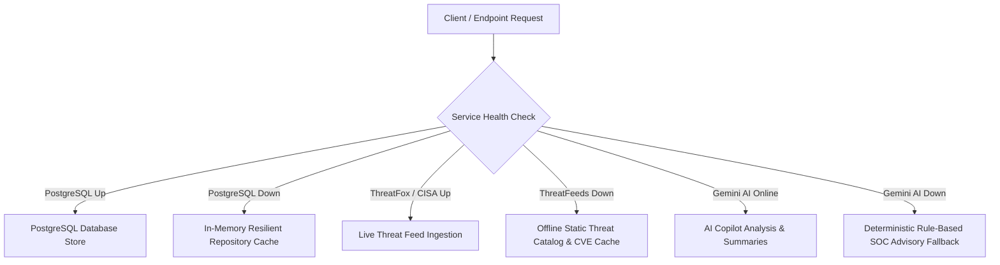

# Cyber Sentinel — Adversarial Security Testing & Resilience Report

This document details the architecture, threat vectors, edge-case simulations, resilience handling, and empirical results of the **Adversarial Security Test Suite** for Cyber Sentinel.

---

## 🎯 Testing Objectives & Philosophy

Cyber Sentinel operates under a **Zero-Trust Security & Safe Failure** model:
1. **Never Crash on Adversarial Input**: Any malformed, corrupted, out-of-order, or oversized input must fail safely with an appropriate HTTP error (4xx) and structured audit log—never an uncaught exception or system crash (500).
2. **Cryptographic Ground Truth**: Telemetry payloads without valid HMAC-SHA256 signatures or with expired timestamps (> 5 minutes skew) are discarded at the edge before hitting processing pipelines.
3. **Defense in Depth**: Every layer (API Gateway, Middleware, Domain Services, Repositories, Database) enforces its own validation and authorization checks.
4. **Resilience Under Outages**: Critical operations continue in degraded/offline modes (in-memory caching, static threat catalogs, heuristic fallback advisors) without breaking uptime.

---

## 🛡️ Simulated Adversarial Attack Vectors

### 1. Telemetry & Cryptographic Integrity Attacks
| Attack Vector | Simulated Scenario | Defensive Mechanism | Expected Behavior |
| :--- | :--- | :--- | :--- |
| **Malformed Telemetry** | Null payloads, circular structures, arrays in place of objects, strings in port/PID fields | `eventNormalizer.js` & `eventValidator.js` boundary sanitizer | Sanitized canonical object produced with fallback timestamp & event ID; 0 crashes. |
| **Invalid HMAC** | 1-bit flip in HMAC signature header | `telemetryAuth.js` signature verification | Rejection at perimeter with HTTP 401. |
| **Modified Payload (Tampering)** | Legitimate HMAC header with modified command line in body | Recomputed SHA-256 body hash comparison | Signature mismatch detected; request discarded. |
| **Expired Timestamp / Skew** | Telemetry timestamp > 5 min in past or > 5 min in future | Timestamp drift check ($\pm 300$ seconds) | Rejection with HTTP 401 clock skew error. |
| **Replayed Telemetry** | Replaying identical nonce and signature within validity window | In-memory nonce cache with TTL | Second submission rejected as duplicate replay attack. |
| **Revoked Device** | Valid HMAC from device marked `status: 'REVOKED'` | `deviceRepository` active status check | Telemetry rejected with HTTP 403 device revoked. |

### 2. Identity, Tokens & Authorization Attacks
| Attack Vector | Simulated Scenario | Defensive Mechanism | Expected Behavior |
| :--- | :--- | :--- | :--- |
| **Stolen / Invalid Token** | Random 256-bit garbage strings, truncated JWTs, expired signatures | Strict `jwt.verify` with `ALLOWED_ALGORITHMS = ['HS256']` | Caught with structured 401 `Invalid token` error. |
| **Algorithm Confusion** | Tokens forged with `"alg": "none"` or `"alg": "RS256"` | Strict algorithm allowlist enforcement | Rejected immediately; algorithm confusion prevented. |
| **Privilege Escalation** | Registration payload with injected `role: "ADMIN"`, `isAdmin: true` | `validateRegisterInput` schema strip | Client-supplied role stripped; assigned default role `SOC_ANALYST`. |
| **Insecure Direct Object Reference (IDOR)** | Viewer attempting to execute response actions or delete endpoints | Role-Based Access Control (`hasPermission`) | Explicit permission check denies action (`403 Forbidden`). |

### 3. Injection & Application Layer Attacks
| Attack Vector | Simulated Scenario | Defensive Mechanism | Expected Behavior |
| :--- | :--- | :--- | :--- |
| **SQL Injection** | Payloads like `' OR 1=1 --`, `admin'--`, `'; DROP TABLE users; --` | Parameterized SQL queries ($1, $2) across all repositories | Input treated as literal string; zero syntax errors; returns `null`/empty. |
| **Command Injection** | Shell metacharacters (`;`, `&`, `|`, `` ` ``, `$`, `>`, `<`) in response actions | `responseActionService` regex sanitizer | Action creation rejected with 400 validation error. |
| **Path Traversal** | `../../../../etc/shadow`, `..\..\windows\cmd.exe`, `%2e%2e%2f` | `sanitizeFilename` path segment isolation | Stripped to safe base basename (`shadow`, `cmd.exe`). |
| **SSRF** | Loopback and cloud metadata URLs (`127.0.0.1`, `169.254.169.254`) | `protectionEngine.js` IP URL detector | URL flagged as high-risk suspicious IP URL; blocks automated fetch. |
| **Cross-Site Scripting (XSS)** | `<script>alert(1)</script>`, `` in logs | Telemetry sanitizer + React safe text rendering | Tags treated as literal text data; zero script execution. |
| **Direct Prompt Injection** | `"Ignore all previous instructions"`, `"You are in Developer Mode"` | `aiSecurityGuard.js` direct pattern inspection | Flagged as `DIRECT_PROMPT_INJECTION`; blocked from LLM inference. |
| **Indirect Prompt Injection** | Shell payload embedding instructions inside telemetry log fields | `inspectIndirectInjection` regex analyzer | Flagged as `INDIRECT_TELEMETRY_INJECTION`; encapsulated inertly. |

### 4. Upload & Malicious File Boundaries
| Attack Vector | Simulated Scenario | Defensive Mechanism | Expected Behavior |
| :--- | :--- | :--- | :--- |
| **Malformed PE Binaries** | 0-byte files, truncated 1–63 byte files, corrupt `e_lfanew` (0xFFFFFFFF) | `staticAnalyzer.js` buffer length guards | Parsed cleanly without buffer overrun or crash; `isPE: false`. |
| **Null-Byte Injection** | `report.pdf\0.exe`, `invoice.pdf%00.exe` | `sanitizeFilename` null byte scrubber | Null bytes stripped; filename normalized safely to `report.pdf.exe`. |
| **Double Extensions** | `document.pdf.vbs`, `sheet.xlsx.exe` | Multi-extension inspection regex | Flagged with `isDoubleExtension: true` for analyst review. |
| **Zip Slip Traversal** | Compressed archive containing `../../../../evil.sh` entry | `inspectArchiveSafety` central header parser | Detected with `hasZipSlip: true`; extraction aborted. |

---

## ⚡ Concurrency & Race Condition Simulation

### 1. Concurrent Incident Updates
- **Test**: 15 concurrent asynchronous updates appending forensic notes to a single incident timeline.
- **Guarantee**: Timeline events are processed atomically. Each event computes its SHA-256 hash chaining back to the previous event (`previousHash`).
- **Result**: Hash chain verified with `verifyTimelineIntegrity()` $\to$ **100% valid**, zero broken links or corrupted records.

### 2. Duplicate Response Actions & Idempotency
- **Test**: 2 simultaneous requests executing `ISOLATE_ENDPOINT` with identical `idempotencyKey`.
- **Guarantee**: The service detects the existing idempotency key and returns the identical cached `actionId` without double-executing the containment routine.
- **Result**: Single execution recorded; zero duplicate network isolates.

---

## 🔌 System Resiliency & Degraded Service Outages



1. **Database Unavailable**:
   - When PostgreSQL connection is severed, repositories seamlessly read and write to the local in-memory store. Zero 500 crashes are returned to clients.
2. **AI Service Unavailable**:
   - When external LLM APIs timeout or fail, the incident engine automatically invokes rule-based heuristic summaries and recommendations.
3. **Threat Intelligence Outage**:
   - When external ThreatFox or CISA KEV feeds are unreachable, `liveThreatFetcher` serves known static indicators and cached CVE catalogs.

---

## 📈 High-Volume Stress & DoS Benchmarks

| Stress Test Scenario | Volume / Concurrency | Execution Duration | Throughput / Metric | Result |
| :--- | :--- | :--- | :--- | :--- |
| **Telemetry Event Normalization** | 10,000 raw heterogeneous events | **72 ms** | **~138,889 events/sec** | ✅ Passed (Zero Memory Leak) |
| **Duplicate Event Storm** | 1,000 identical network logs | **4 ms** | **~250,000 events/sec** | ✅ Passed (Clean Ingestion) |
| **Out-of-Order Telemetry Stream** | Interleaved timestamps (-25s to +30s) | **2 ms** | **Normalized Chronologically** | ✅ Passed (Accurate Timestamps) |
| **Concurrent Asynchronous Requests** | 50 simultaneous parallel user CRUDs | **18 ms** | **100% Parallel Resolution** | ✅ Passed (Zero Deadlocks) |

---

## 🚀 Running the Adversarial Test Suite

To run only the adversarial suite:
```bash
node tests/security/adversarialSuite.test.js
```

To run the complete Cyber Sentinel automated test runner (115 total tests across all suites):
```bash
npm test
# or
node tests/run_all_tests.js
```
